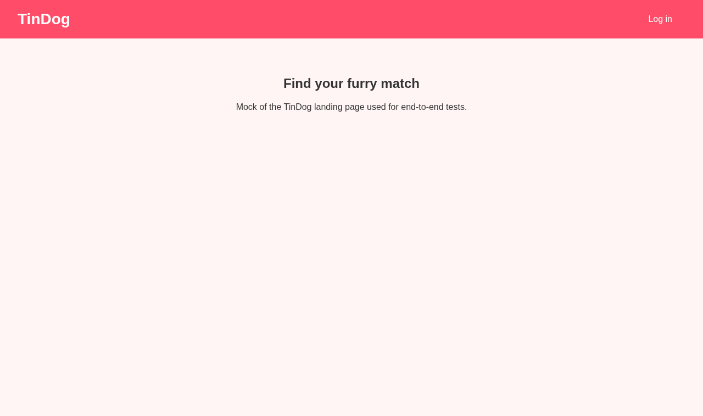
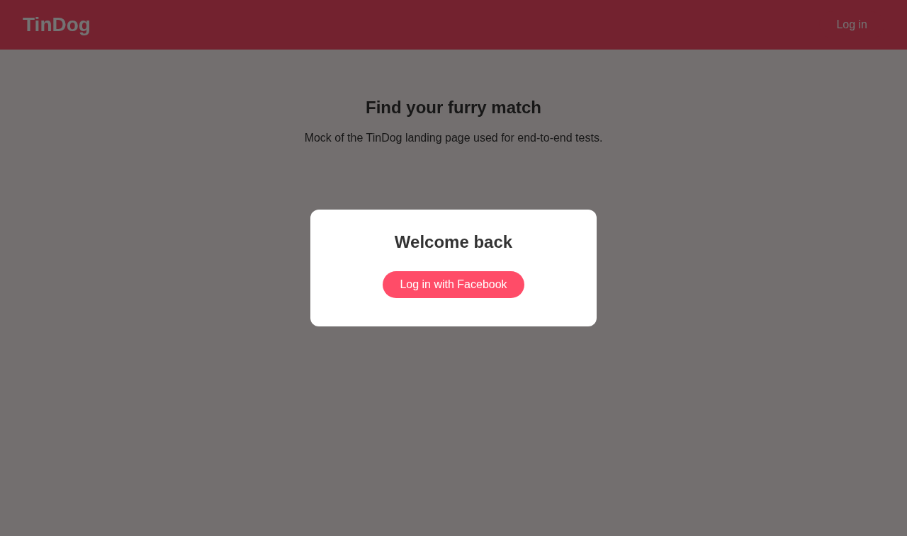
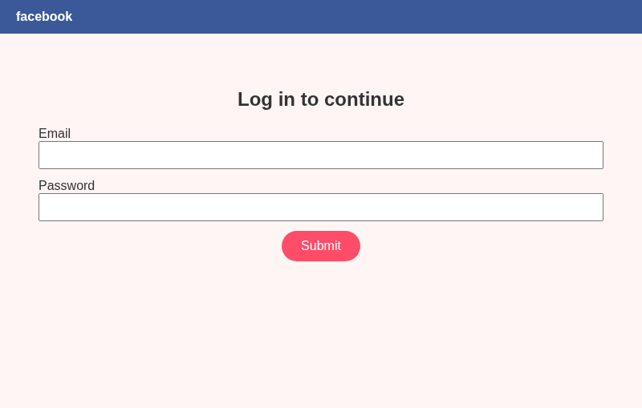
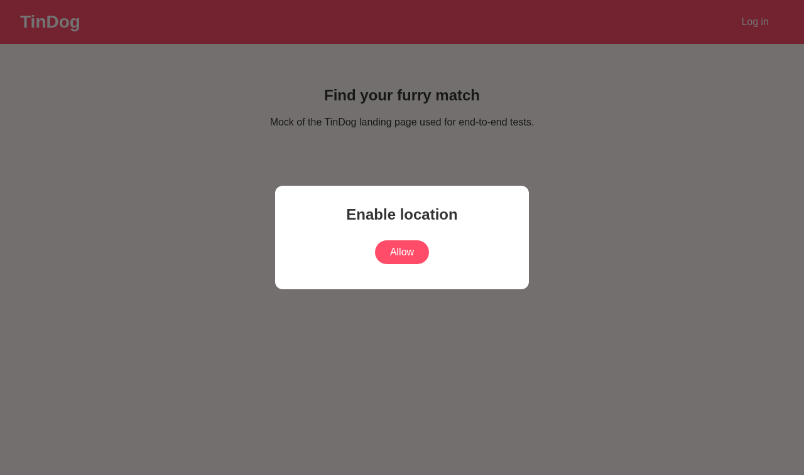
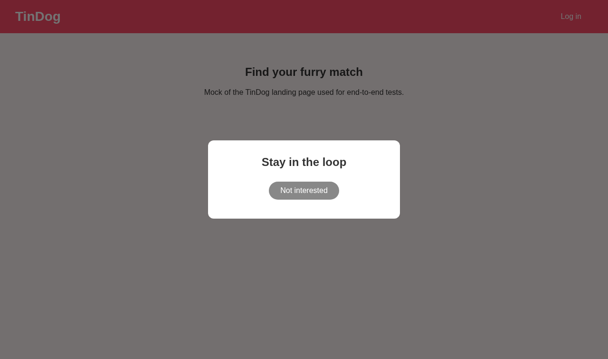
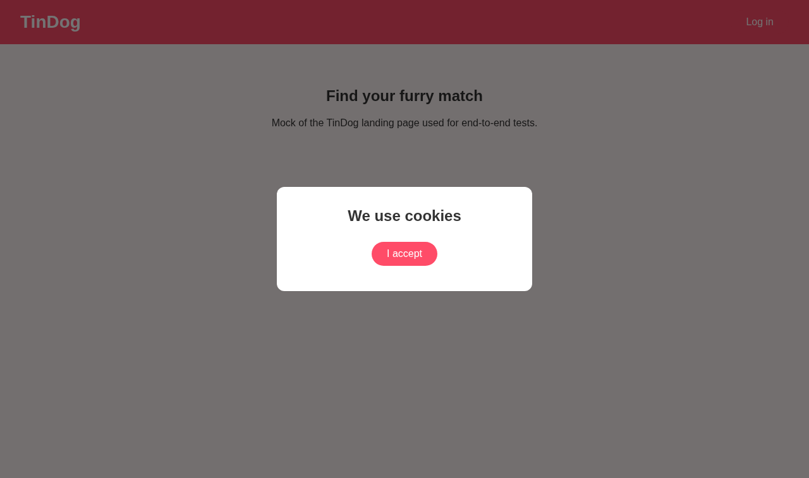
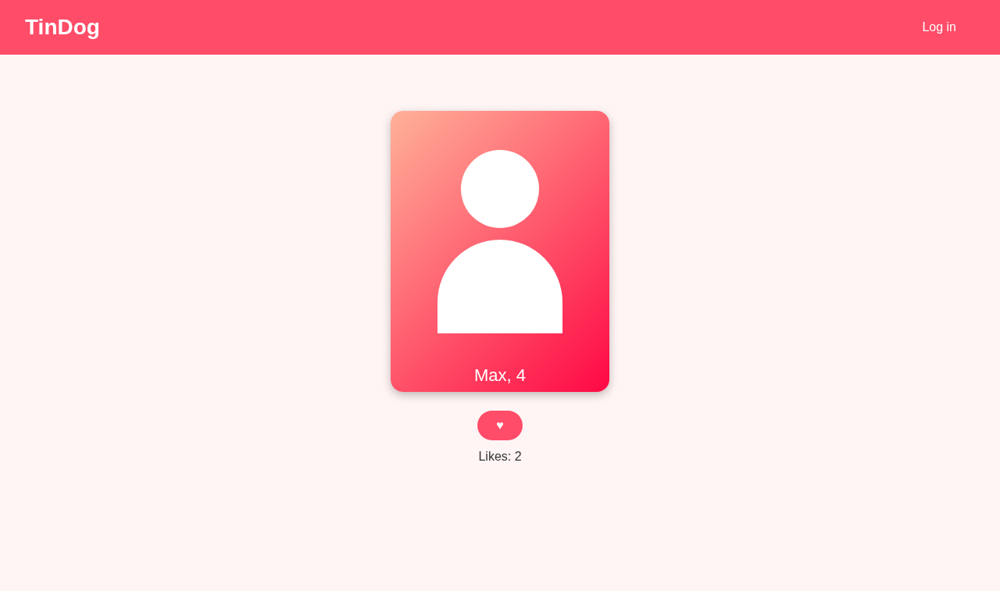
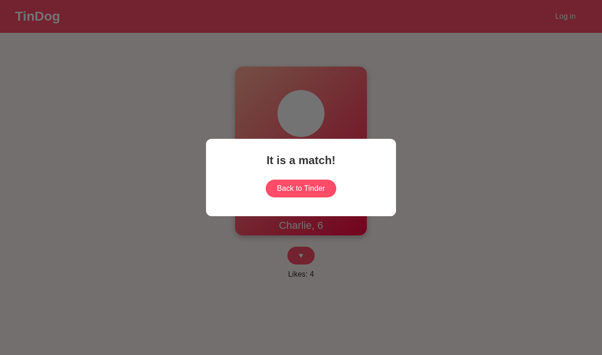
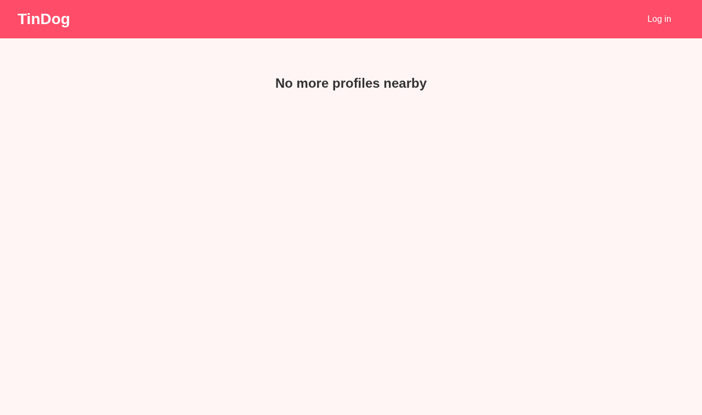

# 050 - Tinder auto find match

Day 50 of *100 Days of Code: The Complete Python Pro Bootcamp*. A Selenium bot
that logs in to **TinDog** (the course's Tinder clone,
<https://app.100daysofpython.dev/>), dismisses the pop-ups and likes profiles.
It is a modernised version of the
[earlier solution](https://github.com/Tirsvad/udemy.python.100-days-of-code/tree/main/day-50-tinder-auto-find-match).

Wiki (what each step teaches): [English](docs/wiki/en/Home.md) ·
[Dansk](docs/wiki/da/Home.md) · [Bahasa Malaysia](docs/wiki/ms/Home.md)

> Be honest with the people you date: tell them you automate your swiping.
> TinDog allows 20 likes a day, Tinder 100 on the free tier.

## Run

```bash
python -m venv .venv && .venv/Scripts/activate   # Windows; use bin/activate on Linux
pip install -e ".[dev]"
cp .env.example .env                             # then fill in your own values
python -m tinder_bot
python -m pytest                                 # unit tests
```

Credentials come from environment variables (`FACEBOOK_EMAIL`,
`FACEBOOK_PASSWORD`); `.env` is git-ignored. Sign in manually once so the
Chrome profile in `.data/` remembers the session and phone verification.

## Layout

| Path | Purpose |
| --- | --- |
| `src/tinder_bot/steps.py` | one function per lecture step |
| `src/tinder_bot/locators.py` | every XPath in one place |
| `src/tinder_bot/config.py` | settings from the environment |
| `tests/unit/` | tests with a fake driver |
| `tests/e2e/` | mock TinDog site and Docker runner that produces the screenshots |

## Steps and screenshots

Screenshots are produced by `tests/e2e` against a local mock of TinDog, run in
Docker (never on the host desktop), into `docs/screenshots/`.

| Step | What the bot does | Screenshot |
| --- | --- | --- |
| 1 | Open the site |  |
| 2 | Click LOG IN, then LOG IN WITH FACEBOOK |  |
| 3 | Facebook pop-up window |  |
| 4a | Allow location |  |
| 4b | Not interested in notifications |  |
| 4c | I accept cookies |  |
| 5a | Liking profiles (waits while loading) |  |
| 5b | Match pop-up, BACK TO TINDER |  |
| 5c | Daily limit reached |  |

> Status: the screenshot files are generated by the Docker run; see
> `tests/e2e/README.md`.
