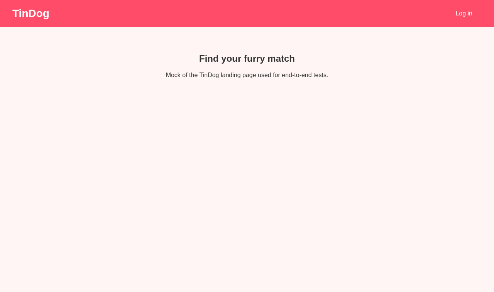
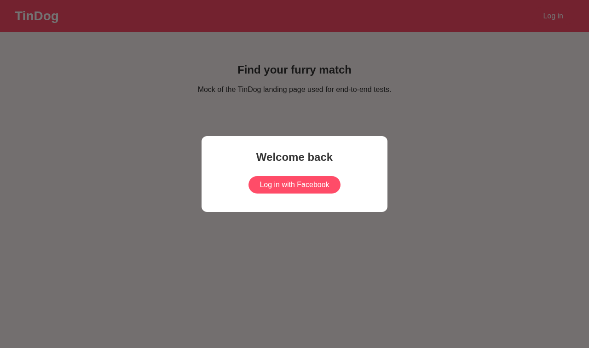
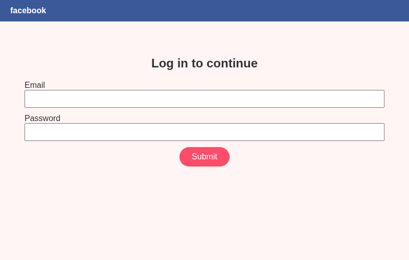
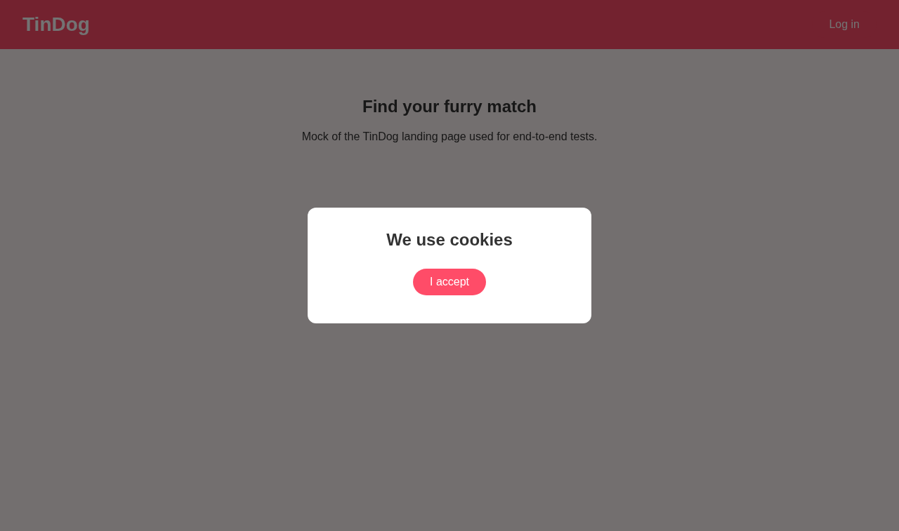
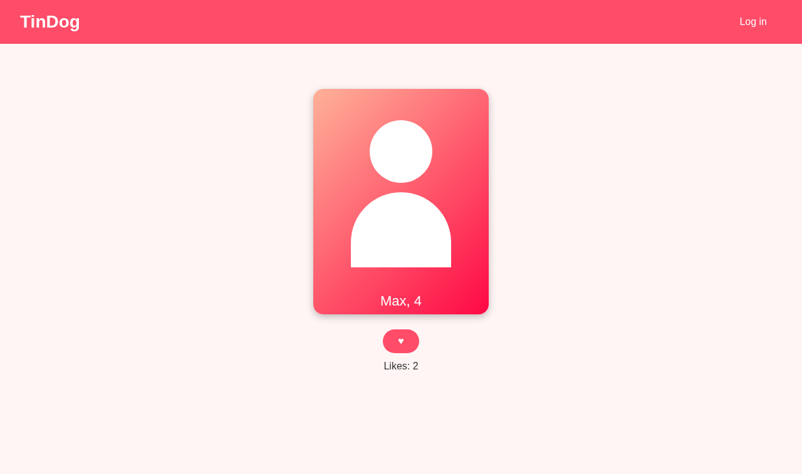
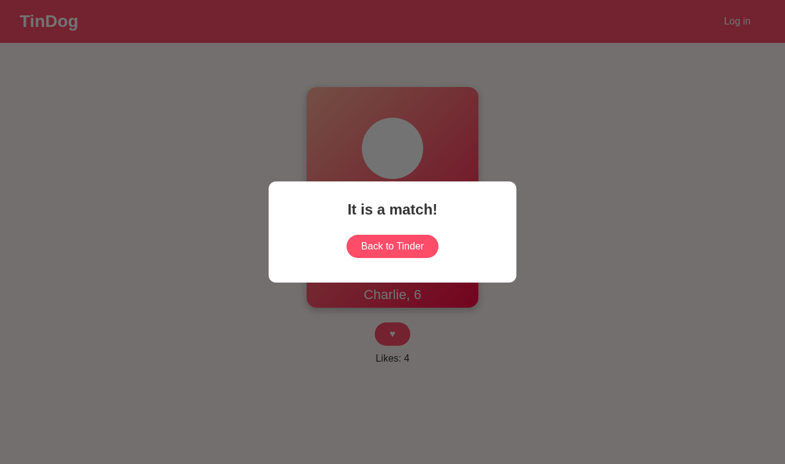
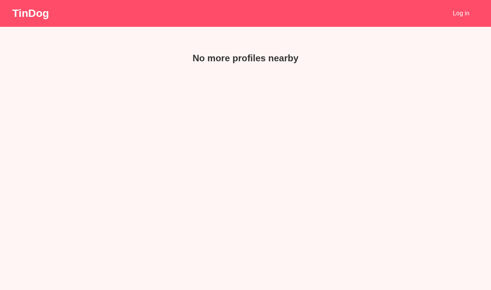

# Day 50 - Tinder auto find match (English)

[Dansk](Home-da) · [Bahasa Malaysia](Home-ms)

Goal: automate logging in and liking profiles on TinDog with Python and
Selenium. Ethics first: tell your partner you automate, and respect the daily
limit (TinDog 20, Tinder free tier 100).

## Step 1 - Look at the site by hand

**What we gained:** before coding, click through manually and note which
elements you must target. Good locators come from looking at the page first.

## Step 2 - Navigate to the login page

**What we gained:** `driver.get`, locating buttons with XPath
(`locators.py`) and waiting for them with `WebDriverWait` +
`element_to_be_clickable` instead of fixed `sleep` calls. This avoids
`NoSuchElementException` on slow pages.

## Step 3 - The Facebook pop-up

**What we gained:** the login opens a second browser window. We switch with
`driver.window_handles` and `switch_to.window`, fill the form, then switch back.
Credentials live in environment variables, never in code.

## Step 4 - Dismiss all requests
Location ([04](../screenshots/04-location.png)), notifications
([05](../screenshots/05-notifications.png)), cookies
([06](../screenshots/06-cookies.png)).

**What we gained:** modal pop-ups block everything behind them. We click ALLOW,
NOT INTERESTED and I ACCEPT, and skip a pop-up that does not appear
(`TimeoutException` is handled and logged).

## Step 5 - Hit Like

**What we gained:** exception handling as control flow for a flaky UI:
`NoSuchElementException` means "still loading, wait 2 s and retry";
`ElementClickInterceptedException` means "a match pop-up is in the way, click
BACK TO TINDER". A pause between likes keeps the bot from looking like a bot.
The loop stops at the configured limit.

## Modernisation compared with the earlier solution
- `src/` package with one function per step instead of one class with `sleep`.
- Explicit waits instead of fixed sleeps; locators in one module.
- Facebook login (as the lecture asks) instead of Google; settings via a
  `Settings` dataclass; unit tests with a fake driver.
- No `from constants import *`, no HTML dumps, no profile path with `os.getcwd`.
