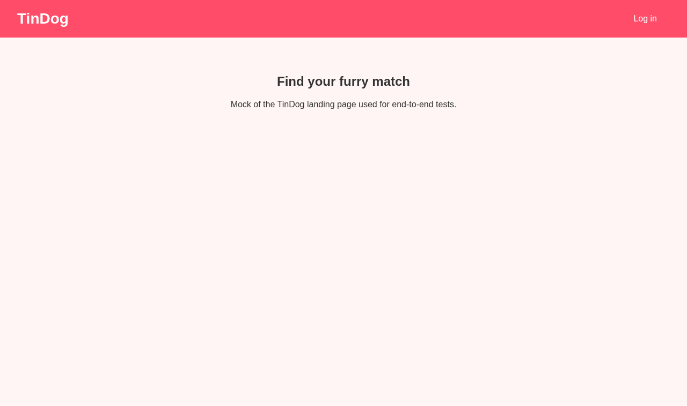
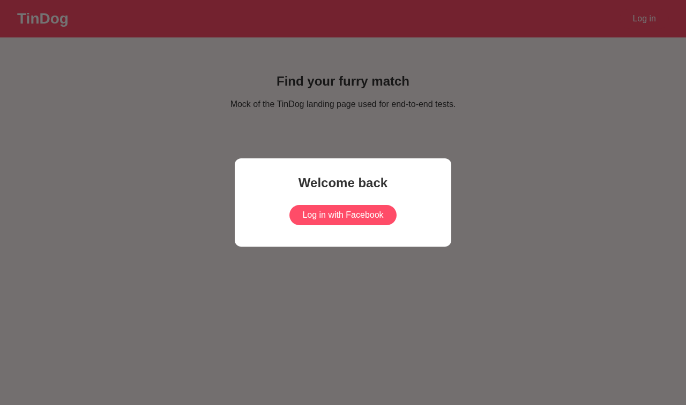
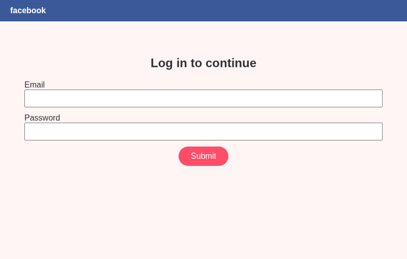
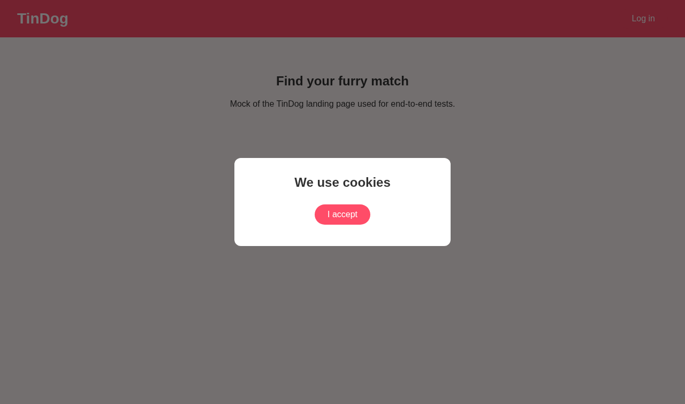
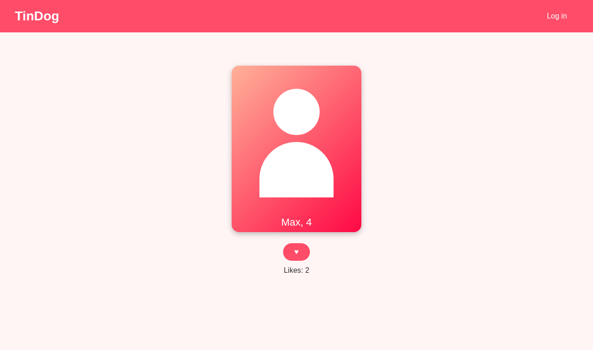
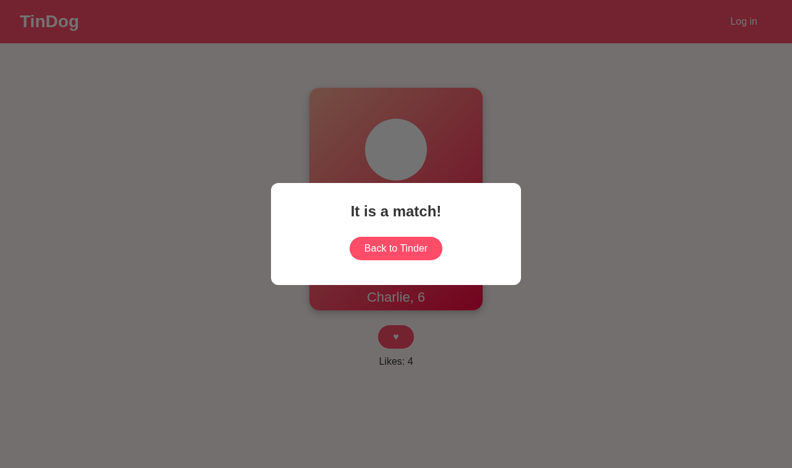
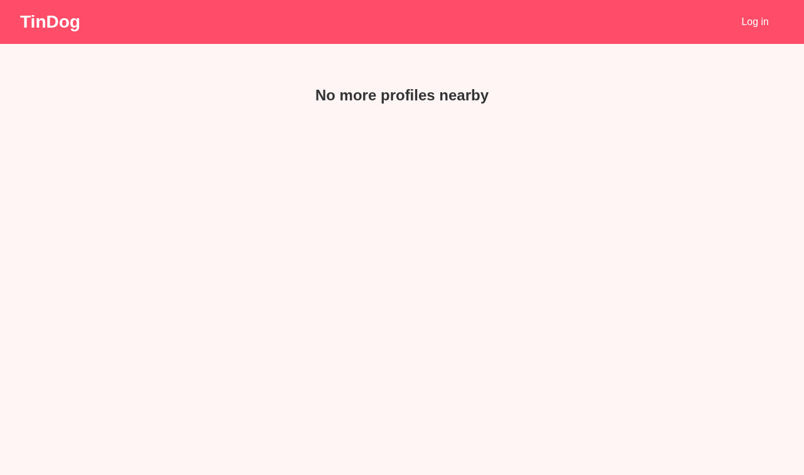

# Dag 50 - Tinder auto find match (Dansk)

[English](../en/Home.md) · [Bahasa Malaysia](../ms/Home.md)

Mål: automatisér login og "like" af profiler på TinDog med Python og Selenium.
Etik først: fortæl din partner, at du automatiserer, og respektér den daglige
grænse (TinDog 20, Tinder gratis 100).

## Trin 1 - Se siden igennem manuelt

**Det lærte vi:** klik først selv igennem og notér, hvilke elementer koden skal
ramme. Gode locators kommer af at kende siden.

## Trin 2 - Gå til login-siden

**Det lærte vi:** `driver.get`, XPath-locators (`locators.py`) og at vente med
`WebDriverWait` + `element_to_be_clickable` i stedet for faste `sleep`. Det
undgår `NoSuchElementException` på langsomme sider.

## Trin 3 - Facebook-popup

**Det lærte vi:** login åbner et ekstra browservindue. Vi skifter med
`driver.window_handles` og `switch_to.window`, udfylder formularen og skifter
tilbage. Loginoplysninger ligger i miljøvariabler, aldrig i koden.

## Trin 4 - Luk alle forespørgsler
Lokation ([04](../../screenshots/04-location.png)), notifikationer
([05](../../screenshots/05-notifications.png)), cookies
([06](../../screenshots/06-cookies.png)).

**Det lærte vi:** modale popups blokerer alt bagved. Vi klikker ALLOW, NOT
INTERESTED og I ACCEPT og springer en popup over, hvis den ikke dukker op
(`TimeoutException` håndteres og logges).

## Trin 5 - Tryk Like

**Det lærte vi:** undtagelser som styring af en ustabil brugerflade:
`NoSuchElementException` betyder "indlæser stadig, vent 2 sek. og prøv igen";
`ElementClickInterceptedException` betyder "en match-popup er i vejen, klik
BACK TO TINDER". En pause mellem likes gør, at botten ikke ligner en bot.
Løkken stopper ved den indstillede grænse.

## Modernisering ift. den tidligere løsning
- `src/`-pakke med én funktion pr. trin i stedet for én klasse med `sleep`.
- Eksplicitte ventetider i stedet for faste; alle locators ét sted.
- Facebook-login (som lektionen beder om) i stedet for Google; indstillinger i
  en `Settings`-dataclass; enhedstests med en falsk driver.
- Ingen `from constants import *`, ingen HTML-dumps.
