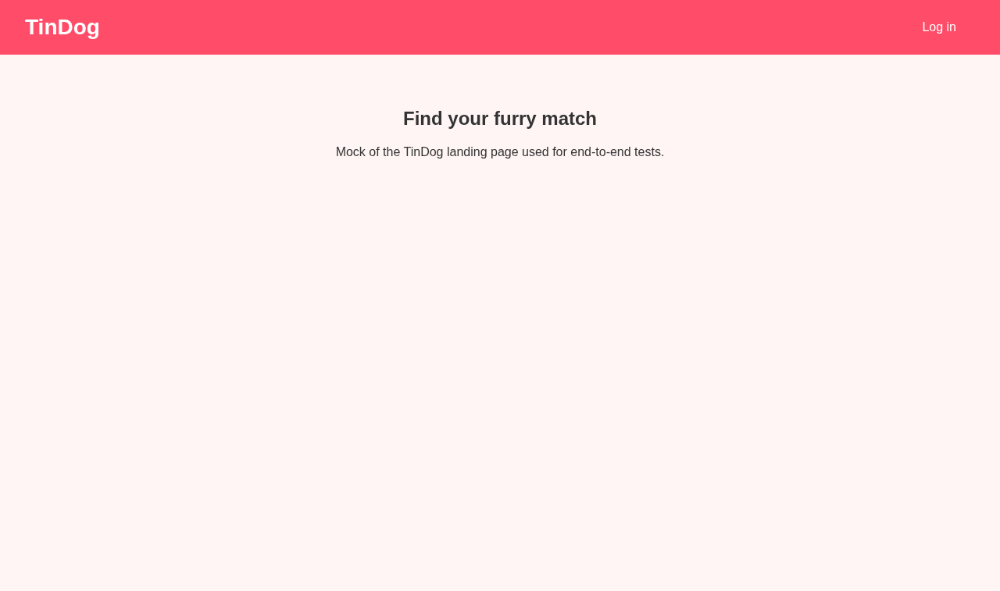
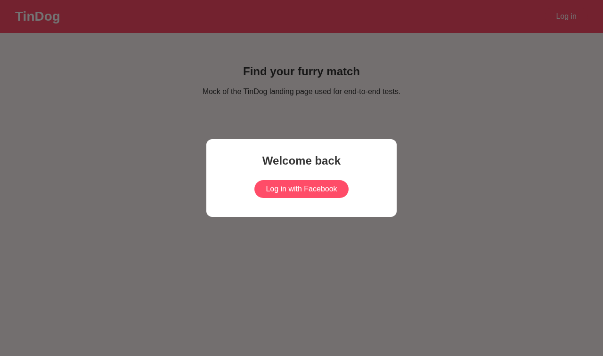
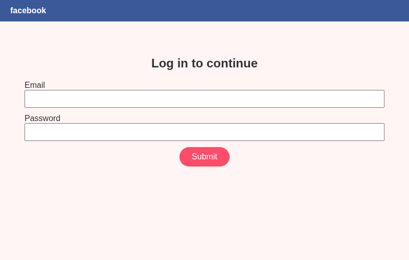
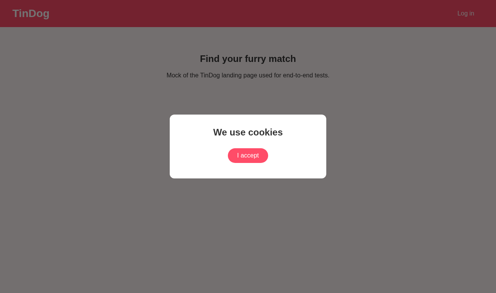
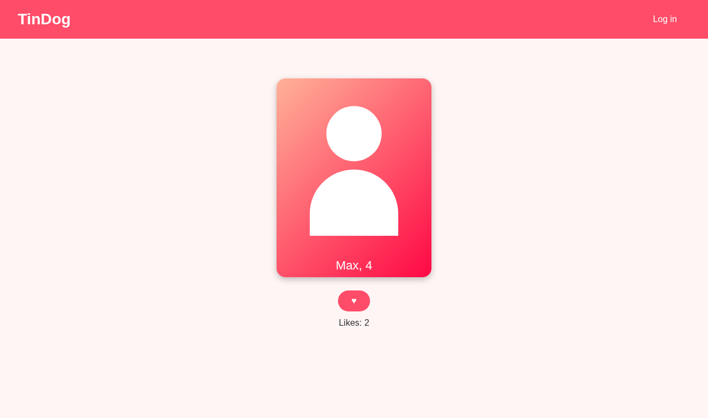
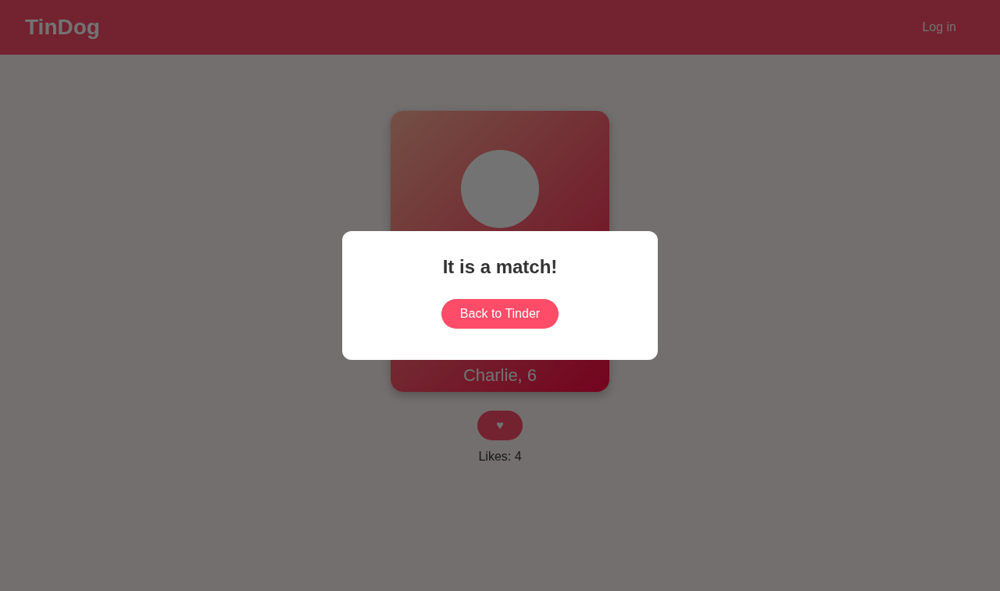
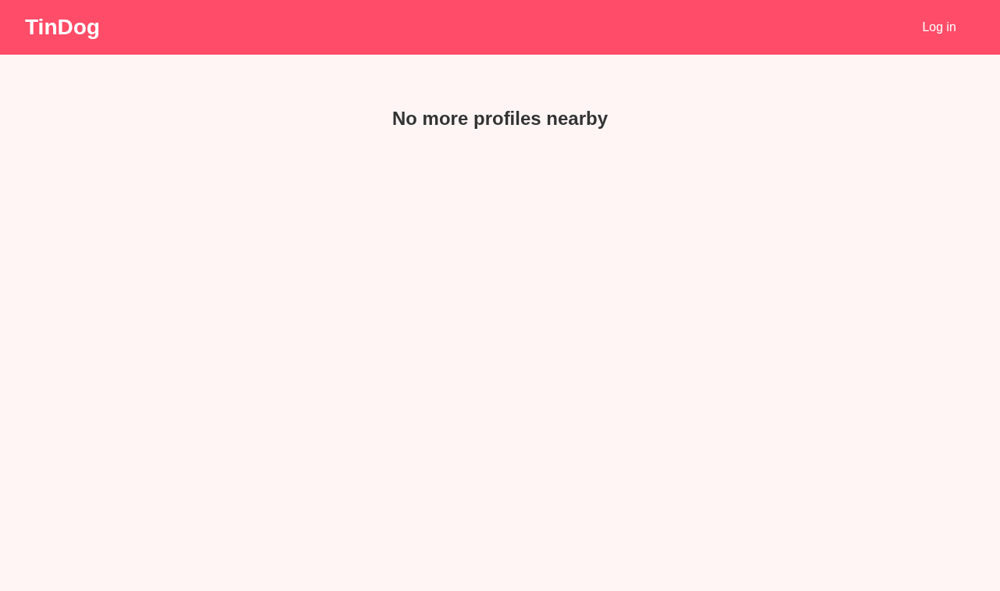

# Hari 50 - Tinder auto find match (Bahasa Malaysia)

[English](../en/Home.md) · [Dansk](../da/Home.md)

Matlamat: mengautomasikan log masuk dan "like" profil di TinDog menggunakan
Python dan Selenium. Etika dahulu: beritahu pasangan anda bahawa anda
menggunakan automasi, dan patuhi had harian (TinDog 20, Tinder percuma 100).

## Langkah 1 - Lihat laman web secara manual

**Apa yang kita pelajari:** sebelum menulis kod, klik sendiri dan catat elemen
yang perlu disasarkan. Locator yang baik datang daripada mengenali halaman.

## Langkah 2 - Pergi ke halaman log masuk

**Apa yang kita pelajari:** `driver.get`, locator XPath (`locators.py`) dan
menunggu dengan `WebDriverWait` + `element_to_be_clickable` dan bukannya
`sleep` tetap. Ini mengelakkan `NoSuchElementException` pada halaman yang
perlahan.

## Langkah 3 - Tetingkap timbul Facebook

**Apa yang kita pelajari:** log masuk membuka tetingkap pelayar kedua. Kita
bertukar dengan `driver.window_handles` dan `switch_to.window`, mengisi borang,
kemudian kembali. Kelayakan disimpan dalam pemboleh ubah persekitaran, bukan
dalam kod.

## Langkah 4 - Tutup semua permintaan
Lokasi ([04](../../screenshots/04-location.png)), pemberitahuan
([05](../../screenshots/05-notifications.png)), kuki
([06](../../screenshots/06-cookies.png)).

**Apa yang kita pelajari:** tetingkap modal menghalang semua yang di
belakangnya. Kita klik ALLOW, NOT INTERESTED dan I ACCEPT, dan langkau yang
tidak muncul (`TimeoutException` dikendalikan dan dilog).

## Langkah 5 - Tekan Like

**Apa yang kita pelajari:** pengecualian sebagai kawalan aliran untuk UI yang
tidak stabil: `NoSuchElementException` bermaksud "masih memuat, tunggu 2 saat
dan cuba lagi"; `ElementClickInterceptedException` bermaksud "tetingkap padanan
menghalang, klik BACK TO TINDER". Jeda antara "like" menjadikan bot kurang
ketara. Gelung berhenti pada had yang ditetapkan.

## Pemodenan berbanding penyelesaian terdahulu
- Pakej `src/` dengan satu fungsi bagi setiap langkah dan bukannya satu kelas
  dengan `sleep`.
- Penantian eksplisit; semua locator di satu tempat.
- Log masuk Facebook (seperti pelajaran) dan bukannya Google; tetapan dalam
  dataclass `Settings`; ujian unit dengan pemacu palsu.
- Tiada `from constants import *`, tiada longgokan HTML.
